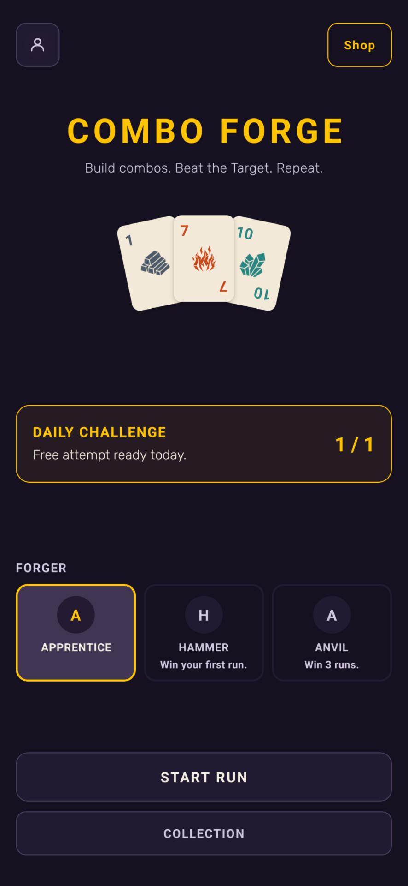
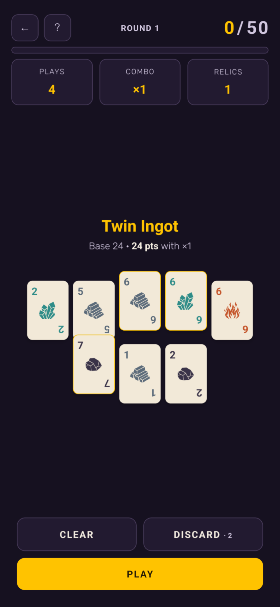
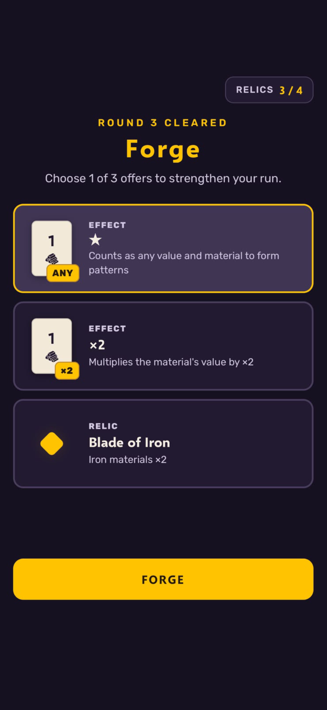
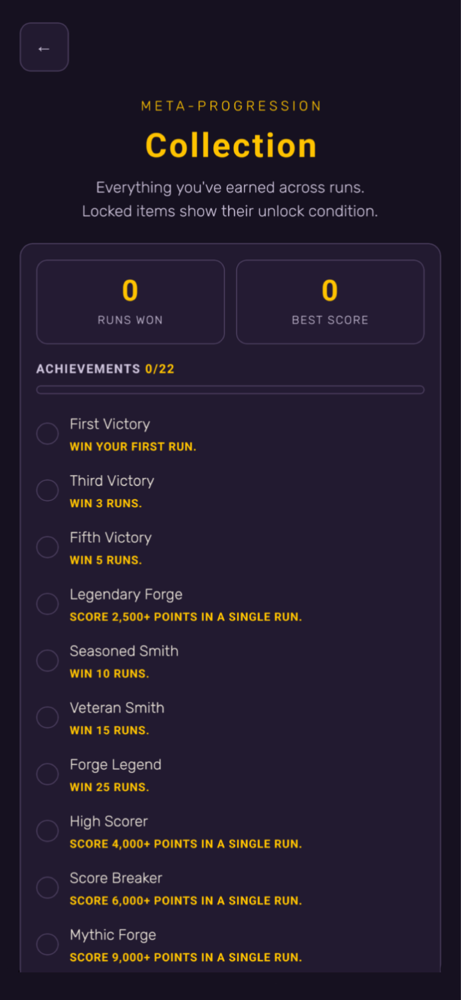

<div align="center">

# Hey, I'm Vitor Verrone 👋

**Software Engineer · 10+ years transforming e-commerce experiences**

[](https://www.linkedin.com/in/vitor-verrone/)
[](mailto:vitor.verrone@outlook.com)
[](https://maps.google.com/?q=São+Paulo,SP)

</div>

---

## About Me

I'm a Software Engineer with **10+ years of experience** building high-impact interfaces and enterprise e-commerce solutions. I specialize in frontend architecture, performance optimization, and checkout flows.

For over **6 years**, I worked on complex integrations for global brands using **Salesforce Commerce Cloud (SFCC/SFRA)**, and I'm always driven by clean code, great UX, and real business impact.

```ts
const vitor = {
  role: "Software Engineer",
  experience: "10+ years",
  location: "São Paulo — Brazil 🇧🇷",
  currentFocus: ["Next.js", "TypeScript", "React", "React Native", "Flutter", "NestJS"],
  languages: { pt: "Native 🇧🇷", en: "Intermediate 🇬🇧" },
};
```

---

## 🚀 Featured Project

<div align="center">


### 🃏 Combo Forge

A short-session roguelike card game for mobile (3–8 min runs). Build card combos that multiply your score and beat each round's target before you run out of plays.

<a href="https://apps.apple.com/us/app/combo-forge/id6809567992"></a>
<a href="https://play.google.com/store/apps/details?id=com.combocardforge.app"></a>






</div>

**Built with:** React Native · Expo · TypeScript · Zustand · Skia · Reanimated · Supabase · RevenueCat · AdMob · Firebase Analytics

**Highlights:** published on iOS and Android · animations with Skia & Reanimated · in-app purchases and rewarded ads · local progress with SQLite · multi-language support (i18n)

---

## 🛠️ Tech Stack

### Frontend


### Mobile


### Backend & Infra


### E-commerce Platforms
-00A1E0?style=flat-square&logo=salesforce&logoColor=white)


